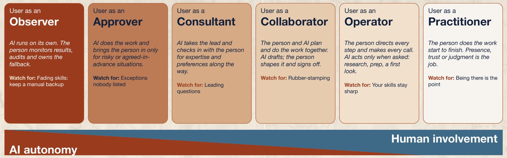
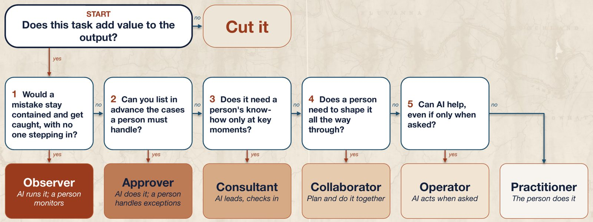

<strong>Find the Balance Point, a three-part series.</strong> 
Part 1: <a href="/field-notes/should-we-use-ai.html">"Should we use AI?" is an incomplete question</a> 
Part 2: Find the balance point, one task at a time (you're here) 
Part 3: <a href="/field-notes/before-you-finalize-the-plan.html">Before you finalize the plan</a>

[Part 1](/field-notes/should-we-use-ai.html) broke a job into tasks and cut the ones that don't add value. This part decides how much AI each remaining task should get. The answer is a point on a scale, not a yes or no, and it can be different for every task in the same job.

## The six levels

As you move right, AI autonomy shrinks and human involvement grows. Every level has a risk to watch.

| Level | The person's role | Watch for |
|---|---|---|
| **Observer** | AI runs on its own. The person monitors results, audits and owns the fallback. | Fading skills: keep a manual backup |
| **Approver** | AI does the work and brings the person in only for risky or agreed-in-advance situations. | Exceptions nobody listed |
| **Consultant** | AI takes the lead and checks in for expertise and preferences along the way. | Leading questions |
| **Collaborator** | The person and AI plan and do the work together. AI drafts; the person shapes it and signs off. | Rubber-stamping |
| **Operator** | The person directs every step and makes every call. AI helps only when asked. | Keeping your skills sharp |
| **Practitioner** | No AI. Presence, trust or judgment is the job. | Make it a choice, not a default |

## Walk the tree: the first yes is the stop

Start with AI running the task alone, then add the person back one level at a time. Stop at the first yes.

| # | Question | If yes, stop at |
|---|---|---|
| Start | Does this task add value to the output? | If no: **cut it** or combine it |
| 1 | Would a mistake stay contained and get caught, with no one stepping in? | **Observer**: AI runs it; a person monitors |
| 2 | Can you list in advance the cases a person must handle? | **Approver**: AI does it; a person handles the exceptions |
| 3 | Does it need a person's know-how only at key moments? | **Consultant**: AI leads and checks in |
| 4 | Does a person need to shape it all the way through? | **Collaborator**: you plan and do it together |
| 5 | Can AI help, even if only when asked? | **Operator**: you direct; AI acts when asked |
| | No to all | **Practitioner**: the person does it; being there is the point |

The order matters. Starting from full autonomy and adding the person back forces you to name *why* a person is needed. Starting from "a person does it" and adding AI tends to stop at whatever feels comfortable.

## An example: four tasks from one job

Here's the tree applied to a recruiting coordinator. These are illustrations, not recommendations; your answers depend on your tools, your volume and your risk.

| Task | How the questions go | Stop |
|---|---|---|
| **Find interview times** | 1: Yes. A bad slot shows up as a calendar conflict and gets fixed. | Observer |
| **Hand off an accepted offer** | 1: No, a missing document can stall a start date. 2: Yes, you can list the exceptions (missing forms, a changed start date). | Approver |
| **Screen candidates** | 1: No, a qualified person screened out never resurfaces. 2: No, you can't list every edge case. 3: No, judgment is needed on every candidate. 4: Yes. | Collaborator |
| **Approve the offer** | 1 to 4: No, this is a person's call. 5: Yes, AI can pull market data when asked. | Operator |

One job, four different balance points. That's the point of asking task by task.

## Where this comes from

The six levels adapt Kevin Feng, David McDonald and Amy Zhang's ["Levels of Autonomy for AI Agents"](https://arxiv.org/abs/2506.12469) (University of Washington and the Knight First Amendment Institute, 2025). Their method of starting with no human help and adding it back until the results meet the bar is the basis for this tree. The No AI level, the questions and the three checks in Part 3 are mine.

## What's next

A balance point is a draft until it survives three checks: cost, scale and risk. That's [Part 3: Before you finalize the plan](/field-notes/before-you-finalize-the-plan.html).
