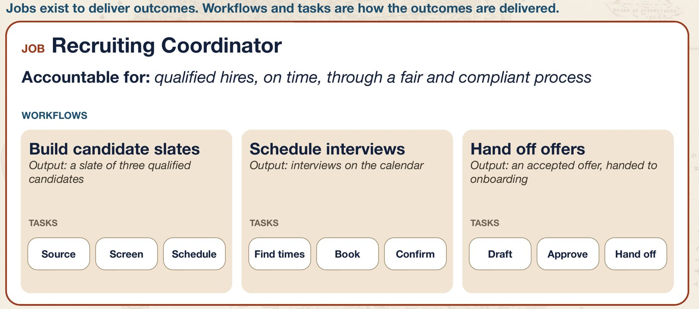

<strong>Find the Balance Point, a three-part series.</strong> 
Part 1: "Should we use AI?" is an incomplete question (you're here) 
Part 2: <a href="/field-notes/find-the-balance-point.html">Find the balance point, one task at a time</a> 
Part 3: <a href="/field-notes/before-you-finalize-the-plan.html">Before you finalize the plan</a>

"Should we use AI?" is an incomplete question for employers. AI doesn't do jobs; it does tasks. The better question is how much AI each task should get, if any at all, and that answer can be different for every task in the same job.

This series walks through how to answer that question one task at a time. It's the method from my "(Re)designing Roles in the Age of AI" workshop, originally launched December 11, 2026, for the AI Ready RVA HR Cohort.

**Tasks may be automated. Accountability is not.**

## Start with what the job is for

Jobs exist to deliver outcomes. Workflows and tasks are how the outcomes are delivered. Before you can decide anything about AI, write down all three:

1. **The outcomes the job is accountable for.** Not the duties list from the job description: the results someone would notice if they stopped.
2. **The workflows that produce those outcomes.** Each one ends in an output you could point to.
3. **The tasks inside each workflow.** Small enough that one person or one tool could do it start to finish.

A recruiting coordinator is accountable for qualified hires, on time, through a fair and compliant process. That outcome comes from three workflows, and each workflow is a handful of tasks.

Here's why this matters. If you ask "should we use AI for recruiting coordination?" you get a yes-or-no argument. If you ask it about *booking an interview* and then separately about *screening a candidate*, you get two very different, much more useful answers.

## The start question: does this task add value to the output?

Before you decide how much AI a task gets, ask whether it should exist at all.

Most workflows carry tasks that made sense once: a report nobody reads, an approval that never says no, a spreadsheet re-keyed into another system. Automating those just makes waste faster. In 1990, Michael Hammer put it bluntly in the *Harvard Business Review*: "Don't automate, obliterate."

A practical way to test it: give an AI tool the output and the inputs, not today's route, and ask it for a different way to get there. Treat the answer as a brainstorm, not a decision. You're still accountable for the process, and you judge whether the solution works.

If the answer is no, cut it or combine it. Don't automate it.

## What's next

Once you're down to tasks that earn their place, the next step is deciding how much AI each one gets, from "AI runs it alone" back to "a person does it." That's the decision tree in [Part 2: Find the balance point](/field-notes/find-the-balance-point.html).
